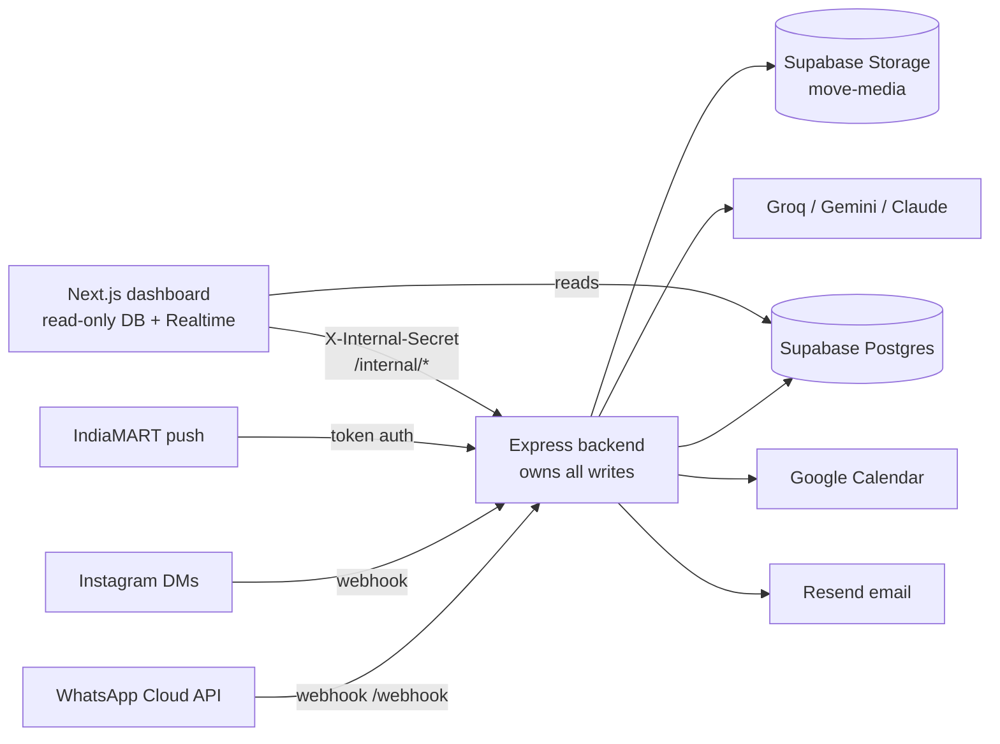

# Architecture: Express backend

Companion document: [`suryodaya-dashboard/ARCHITECTURE.md`](../suryodaya-dashboard/ARCHITECTURE.md). This file describes the backend; the dashboard file describes the UI and the trust boundary from its side.

Stack: Node 22, TypeScript (strict, NodeNext ESM), Express 5, the `postgres` library against Supabase Postgres (not `supabase-js`), Jest (ESM, `node --experimental-vm-modules`). Last reviewed 4 November 2026 (Express `85a6e03`).

## 1. System overview

## 2. Principles (do not revert)

1. **Express owns every write.** The dashboard reads Postgres directly and gets live chat through Supabase Realtime, but every state change goes through `/internal/*` with the shared secret.
2. **No invented facts.** The AI states company facts only from `src/company`, and prices only from the ballpark lookup table. Not offered: storage, vehicle transport, international moves. The GST badge is text only.
3. **A human confirms before a quote is final.** Photo and video estimates are provisional; the on-site survey (free, about 15-30 minutes) is the confirmation.
4. **Consent and the 24-hour window are enforced in code**, not by convention (section 10).
5. **Idempotence everywhere that can repeat:** schema creation, webhook processing, scheduled sends and survey claims all tolerate being run twice.
6. **Fail safe, say so honestly:** when something external fails (calendar, a provider, delivery) the customer gets an honest message and the team gets a signal; nothing is silently swallowed.

## 3. Startup order (`src/server.ts`)

Database connect and `initSchema()` (idempotent, includes the lockdown block) -> AI router initialisation and the profile line -> HTTP listen -> admin-alert summary -> calendar summary -> follow-up scheduler (`FOLLOWUPS_ENABLED`) -> lifecycle jobs (`LEAD_AUTOCLOSE_HOURS`) -> Instagram token job. Each background starter is wrapped so a failure to start one never stops the server.

## 4. Data model

All tables are created by `initSchema()` in `src/leads/db.ts`. Row-level security is enabled on all of them and `anon` and `authenticated` have every right revoked, **except** `SELECT` on `messages` for `authenticated`, which the dashboard's Realtime subscription needs. The server connects with a role that bypasses this.

| Table | Purpose |
|---|---|
| `contacts`, `contact_identities` | A person and their channel identities (phone, Instagram id). WhatsApp and Instagram are never merged. |
| `leads` | One *enquiry*: status, extracted move fields, `human_takeover`, `escalated`/`escalated_at`, `closed_at`. |
| `messages` | Every inbound and outbound message (`channel`, `direction`, `message_type`, nullable `wamid`). |
| `media_captures` | Photo and video analyses: room key and qualifier, items, totals, provider used. |
| `booking_offers` | Offered and chosen survey slots, `selected_slot`, `responded_at` (confirmation time), `survey_starts_at`, `calendar_event_id`, `calendar_status`. |
| `consents` | Append-only consent history per contact, channel and scope. The newest row wins. |
| `touchpoints` | Every contact point of a lead (WhatsApp, IndiaMART, follow-ups). |
| `admin_notifications` | Alerts sent to the team, by channel and status. |
| `processed_messages` | Webhook de-duplication by message id. |
| `intake_rejects` | IndiaMART payloads that failed validation. |
| `survey_settings` | One row of admin-edited scheduling overrides. |
| `scheduled_actions` | Claim table for automated follow-ups: unique per (lead, kind, ref). |
| `delivery_events` | WhatsApp messages that failed after Meta accepted them. |
| `integration_tokens` | The refreshed Instagram token and its expiry (server-only). |

## 5. Inbound WhatsApp pipeline (`src/whatsapp/webhook.ts`)

1. Verify the Meta signature; answer `200` immediately.
2. Fire-and-forget: extract any **failed delivery statuses** and record them (section 12).
3. Queue per sender so one customer's messages are processed in order.
4. For each message: de-duplicate by message id (`processed_messages`), then **resolve the enquiry** (section 6) and log the inbound message (text and button taps).
5. In order, the first match handles it:
   - Outreach intents: STOP, "not now", "yes continue" (consent).
   - Automation buttons: Confirm time, Change time, Show me times, Talk to a human.
   - Interactive list taps: Talk to a Human, Book a Survey, Get Estimate, Get My Move Total, Update details.
   - A reply to an open slot offer.
   - Media: download, store, analyse, de-duplicate, reply (section 8).
   - Free text: room-correction or "same room" replies, a YES after an automated nudge, otherwise **one AI turn** that extracts fields, writes the reply and may flag a booking, human or team-follow-up intent.
6. If human takeover is on for the lead, the AI is skipped.

`webhook.ts` is large (about 800 lines). Change it in small, targeted edits only.

## 6. Enquiry resolution

`resolveEnquiry` finds the contact by identity or phone, then the contact's newest enquiry. It **creates a new enquiry** when there is none, when the newest has `closed_at`, or when it has been idle more than 30 days. STOP and "not now" always attach to the existing one. Booked leads are auto-closed 48 hours after the survey (section 13), so a returning customer starts fresh.

## 7. AI layer (`src/ai`)

- A router with provider adapters for Groq, Gemini and Claude, and per-task chains. Demo profile: text `groq -> gemini`, images `groq -> gemini`, video `gemini` only (no fallback). Production profile: text `claude -> gemini -> groq` when Claude is listed first *and* its key passes a one-token validation.
- Structured outputs are schema-validated; a response that fails validation triggers failover.
- The validation failure reason (HTTP status and the provider's message) is logged with keys redacted.
- Startup warnings flag configuration that cannot work, for example an Anthropic key that no chain uses.
- **The Claude path is unverified** pending a funded account.

## 8. Photo and video estimates

`src/flows/volumetric.ts` builds the prompt from what is already counted, calls the vision chain, and `finalizeVolumetric` computes totals. The AI returns a room type; the backend resolves the **room key and qualifier** (for example Kids Bedroom) deterministically.

- **De-duplication:** the model marks lines already counted. A deterministic second pass (`room-dedupe.ts`) token-matches item names (articles and size words dropped, singularised, subset match) against what the room already holds, consuming quantities so a unit is never matched twice, and splitting partly covered lines.
- **Corrections:** "this is the kids bedroom" relabels the latest photo (15-minute window) and re-de-duplicates against the target room; "same room" re-runs de-duplication within the room.
- **Collision notice:** if a new photo lands in an existing same-type room without the model matching it, the reply asks the customer whether it is the same room.
- Totals roll up through `quote-build.ts` into the **Get My Move Total** message. A whole-flat video gets one room key (known limit).

## 9. Survey scheduling

- `src/calendar` generates candidate slots in India time from the settings (working days and hours, lunch break, duration, step, concurrency, notice, horizon, holidays), checks Google free/busy, and picks a few spread-out options.
- **Settings precedence:** the stored `survey_settings` row overrides `.env` key by key; a 30-second cache serves reads and is cleared on every save; a database failure serves the last good value or the `.env` values. Saves are validated strictly (any parser warning rejects the save).
- **Claim and confirm:** claiming re-checks free/busy for the chosen slot, inserts the event on the dedicated "Suryodaya Surveys" calendar, then `booking-finalize.ts` records the selection, sets the lead to booked, sends the confirmation, cancels the **previous** event on a rebooking and alerts the team.
- **Calendar failure:** when the insert fails (status `failed`), the customer is told the slot is noted and the team will confirm, the lead is escalated, the team gets a "Survey booked, calendar not updated" alert, and the previous event is still cancelled. When no calendar is configured the flow offers fixed example times and still confirms normally.
- Which booking counts is the **latest confirmed** one (`responded_at`), not the one with the latest start time.

## 10. Alerts, outreach and consent

- **Admin alerts** (`src/notify`): events `booking_confirmed`, `calendar_failed`, `human_requested`, `needs_followup`. Email via Resend and a WhatsApp `admin_alert` template. Booking-type events are de-duplicated per slot for 10 minutes. `needs_followup` alerts once, then at most once every 6 hours per lead (the re-alert refreshes `escalated_at`).
- **Policy** (`src/outreach/policy.ts`) turns *phone present, consent state, window open* into exactly one action: `reply_freeform`, `send_template`, `offer_click_to_chat`, `needs_human_call` or `blocked_opted_out`. Everything that sends proactively goes through it.
- **Consent** is an append-only history; the newest row decides. STOP writes `withdrawn`, and only the customer (a "Yes, continue" tap) or an explicit staff entry restores it.
- The 24-hour window is measured from the customer's last inbound message on that channel.

## 11. Automated follow-ups (`src/automation`)

Off unless `FOLLOWUPS_ENABLED=true`. A tick (default every 5 minutes) **re-derives** what is due from each candidate lead's current state; nothing is queued in advance.

| Kind | Sent as | When |
|---|---|---|
| `missing_details` | free text | 3 hours after the customer's last message, once per lead, only if key fields are blank |
| `nudge_inwindow` | free text | 22 hours after silence, while the window is still open |
| `nudge_template` | `enquiry_nudge` | 48 hours after silence (window closed), needs consent |
| `survey_reminder` | text or `survey_reminder` | 24 hours before the survey (3 hours before if booked late) |
| `survey_morning` | free text | 09:00 on the survey day, only for pre-noon surveys and only if the window will still be open |

Guards on every send: consent not withdrawn, not human takeover, lead open, **only the contact's latest lead** (older leads are never nudged), India-time sending hours (default 09:00-20:00), a daily cap, at most two nudges per lead, and the channel must match the window state. Idempotence comes from claiming a unique `(lead, kind, ref)` row before sending; each plan is keyed to the customer's last inbound message, so a reply cancels the old plan. A restart can never double-send. A failed send is recorded as failed and **not** retried. Expired actions leave no row.

Inbound handling: template buttons map to deterministic handlers (Show me times and Change time offer slots without an AI call; Confirm time acknowledges; Stop messages opts out). A bare YES counts as "show me times" only while the nudge is still the last message we sent that lead.

## 12. Delivery failures

Meta can accept a message and fail it later. The webhook extracts `statuses[]` with `status: "failed"` (error code, title and details) and writes `delivery_events` keyed by message id. A matching automated action flips from sent to failed with the reason. Outbound message rows mostly store a null `wamid`, so failures are shown per recipient on the lead page, not per message. The admin is not messaged about these (loop risk).

## 13. Lifecycle and integrations

- **Auto-close** (`src/lifecycle`): an hourly job sets `closed_at` on booked leads whose latest confirmed survey ended more than `LEAD_AUTOCLOSE_HOURS` ago and where the customer has not written within that window.
- **Instagram token** (`src/integrations`): Meta's long-lived token (60 days) is refreshed through `graph.instagram.com/refresh_access_token`. The row is seeded from `.env` with a fingerprint of that value; refreshes update the stored token and dates but **never** the fingerprint, so changing `.env` re-seeds and nothing else does. Sending reads the stored token at call time. Status and a manual refresh are exposed to the dashboard.

## 14. Internal API (`src/routes/internal.ts`)

All routes require `X-Internal-Secret` (constant-time compared against `INTERNAL_API_SECRET`). Responses never echo secrets.

| Route | Purpose |
|---|---|
| `GET/PUT /internal/survey-settings`, `POST /internal/survey-settings/reset` | Admin-controlled scheduling. |
| `GET /internal/leads/:id/automation`, `POST .../automation/cancel` | Upcoming and past automated messages; cancel one. |
| `GET /internal/integrations/instagram`, `POST .../instagram/refresh` | Token status; manual refresh (refused within 23 hours of a success). |
| Outreach, takeover, send-message and move-quote routes | See the file; same secret, same error style (`500 { error: "internal error" }`, message-only logging). |

## 15. Security model

- The shared secret is the only credential between the dashboard and Express; the browser never sees it. The dashboard's Next route handlers check the request Origin and the signed-in Supabase user before proxying.
- Webhooks are authenticated by signature (WhatsApp, Instagram) or token (IndiaMART).
- Row-level security with revoked default grants protects every table from the public API keys.
- Logs never include tokens, keys or full phone numbers.
- Known weak points are listed in the README (secrets rotation, token in the database).

## 16. Where to change what

| Want to change... | Start in |
|---|---|
| What the AI may say or promise | `src/company`, `src/ai` prompts, then run conformance |
| Slot rules | `src/calendar/config.ts`, `settings.ts` |
| Who gets alerted and how | `src/notify` |
| When a follow-up fires | `src/automation/rules.ts` and `config.ts` |
| Consent or window behaviour | `src/outreach/policy.ts`, `consent.ts` |
| Room grouping and de-duplication | `src/flows/rooms.ts`, `room-dedupe.ts`, `room-correction.ts` |
| A new table | `initSchema()` **and** the lockdown block in `src/leads/db.ts` |
